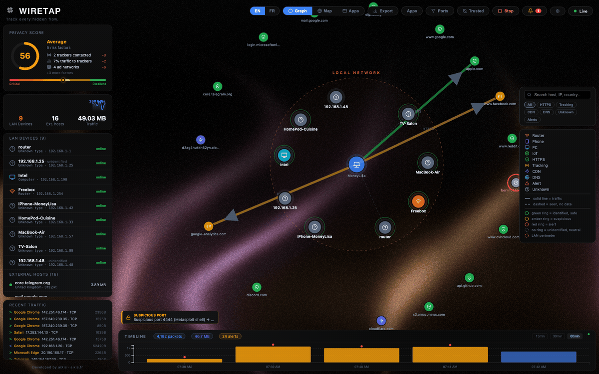

<div align="center">

# Wiretap

**Die Firewall, die weiss, ob DU da warst, als die Daten rausgingen.**

[English](README.md#english) | [Français](README.md#français) | [Español](README.es.md) | **Deutsch** | [Русский](README.ru.md) | [日本語](README.ja.md) | [Português](README.pt-BR.md) | [中文](README.zh-CN.md)

⭐ **Wenn Wiretap dir hilft, bedeutet ein Stern sehr viel!** ⭐

[](LICENSE)
[]()
[]()
[-blue.svg)]()
[](https://github.com/aixisstudio/Wiretap/releases/latest)
[](https://github.com/aixisstudio/Wiretap/stargazers)

<!-- DE: Live-Aufnahme des Demo-Modus (WIRETAP_DEMO=1) — nur synthetischer Traffic. -->


</div>

---

**Wiretap** ist ein Echtzeit-Visualizer für Netzwerkverkehr.
Sieh jede Verbindung deines Computers — mit wem er spricht, wo der Server steht und welche App verantwortlich ist.

Die gesamte Oberfläche ist in **English, Français, Español, Deutsch, Русский, 日本語, Português (BR) und 简体中文** verfügbar: Sprachauswahl in der Symbolleiste oben rechts.

### Warum Wiretap?

- **vs Little Snitch / Lulu** — gleiche Idee (App-weise Sichtbarkeit + Blockierregeln), aber Wiretap ist plattformübergreifend, kostenlos und Open Source. Blockiert wird über die native OS-Firewall (`netsh` / `iptables` / `pf`) — Wiretap filtert nie im User-Space.
- **vs GlassWire** — Wiretap ist kostenlos, Open Source (AGPL), ohne Konto und macht **keinerlei ausgehende Aufrufe** ohne Opt-in; selbst die Geolokalisierung läuft offline.
- **vs Wireshark** — Wiretap liefert eine lesbare Live-Übersicht statt roher Paketdissektion.
- **vs Cloud-Monitore** — alles läuft auf `127.0.0.1` hinter einem Token; deine Verkehrsdaten verlassen den Rechner nie.

### Die tiefen Signale — v1.9

Alles, was ein klassisches Netzwerk-Tool sehen kann, plus alles, was es nicht sehen kann. Der Intrusion-Zyklus, Ende-zu-Ende geschlossen:

| Signal | Was es tut |
|---|---|
| **Anwesenheitskorrelierte Exfiltration** | 5 MB zu einem KI-Anbieter während du tippst bist du mit deiner IDE; dieselben 5 MB während deiner Abwesenheit sind etwas anderes, das in deinem Namen handelt. OS-Input-Idle-Zeit ohne Privilegien gelesen — `UNATTENDED_EXFIL`. Niemand sonst korreliert Flows mit menschlicher Anwesenheit |
| **Flow DNA** | Netzwerk-Metabolismus pro Prozess — Burst-Grossen, Rhythmus, Out:In-Ratio, Ziel-Entropie — still gelernt, dann bewertet. Eine kompromittierte App behalt ihren Namen, aber andert ihren Metabolismus. `FLOW_DRIFT`-Alarme erklären sich selbst |
| **Herkunfts-Verdikte** | `browser -> sh -> curl -> evil.bin` erzahlt die Geschichte, die ein blosser Prozessname verbirgt — Abstammungs-Scoring mit Beweissatzen |
| **Persistenz-Überwachung** | LaunchAgents, Run-Keys, systemd, cron — jeder Autostart-Mechanismus gefingerabdruckt und alle 5 Minuten verglichen. Den Neustart zu uberleben ist, was Malware am meisten braucht; `PERSISTENCE_NEW/MOD/DEL` |
| **Blast-Radius** | Jeder kritische Alarm tragt eine berechnete Impact-Bewertung — erreichte Ziele, KI-Exposition, erreichbare Secrets, Neustart-Überleben. Triage in einem Satz statt einer Untersuchung |
| **Zeitreise-Diff** | „Was hat sich auf diesem Rechner seit Dienstag geändert?" — Stündliche Snapshots, 48 h Aufbewahrung, erschienen/verschwunden/verandert in Millisekunden |
| **Manipulationssicheres Forensik-Log** | Jeder Alarm per Hash an den vorherigen verkettet — ein Angreifer, der Alarme löscht, bricht die Kette: Die Löschung selbst wird zum Beweis. Offline-Verifikation unter `/forensic/verify` |
| **Kill-Chain-Korrelation** | 3 verschiedene Detektor-Familien auf derselben Entitat in 15 Min sind kein Rauschen — es ist ein einziger Vorfall, als Timeline erzahlt, der den automatischen Lockdown auslosen kann |
| **KI-Traffic-Governance** | Byte-Abrechnung pro (Anbieter, Prozess) uber 21 KI-Anbieter, Shadow-AI-Erstkontakt-Alarme, Massenexport-Erkennung — nur Metadaten, niemals Inhalte |
| **Secret-Egress-Watch** | Lokale DLP — API-Keys aus Env/Dotfiles geerntet (Werte verlassen nie den RAM), alarmiert wenn sie im Klartext die Leitung uberqueren oder zu einem KI-Anbieter fliessen |
| **MCP-Governance** | Risiko-Audit jedes MCP-Servers aus Cursor / Claude / Windsurf / Zed / VS Code / Devin — Download-and-run-Launcher, unbegrenzter Dateizugriff: die neue Angriffsflache der KI-Agenten |
| **Supply-Chain-Watch** | `POSTINSTALL_NET` — ein nie gesehener Prozess, der Minuten nach einer Installation ins Netz geht, ist die Supply-Chain-Kompromittierungs-Signatur |
| **Canaries + Honeyports + Auto-Response** | Ransomware-Köderdateien, passive LAN-Listener auf telnet/SMB/RDP/VNC, opt-in Lockdown oder Prozess-Suspension bei kritischen Alarmen — Erkennung, die handelt |
| **DNS-Firewall + Netzwerkprofile** | Filtern der DNS-Proxy mit verschlüsseltem DoH-Upstream und kuratierten Blocklists; Firewall-Profile wechseln automatisch pro WLAN-SSID/BSSID |
| **Natürlichsprachliche Abfragen** | `/ask` — „hat etwas diese Woche mit Russland gesprochen?" — deterministisch aus SQLite beantwortet, nie halluziniert |

### Funktionen

| Funktion | Beschreibung |
|---|---|
| Force-Graph | Live-Knotengraph — dein Rechner im Zentrum, jede Verbindung ein Knoten |
| Weltkarte | Geolokalisierte IPs mit animierten Bögen auf einem interaktiven Globus |
| Timeline 15/30/60 Min | Gleitende Historie lokal in SQLite (24 h Aufbewahrung) |
| Anomalie-Erkennung | Port-Scans, Beaconing (C2 im Regeltakt), potenzielle Exfiltration |
| Erweiterte Erkennung | DNS-Tunnel-Heuristik, Klartext-Ports, Länder-Baseline-Abweichung pro App |
| Firewall-Orchestrierung | Blockregeln (IP/CIDR/Domain/Prozess/Port) auf die OS-Firewall angewendet — `netsh`/`iptables`/`pf`, persistiert, Blockzähler pro Regel |
| Lockdown-Modus | Panik-Schalter — markiert & blockiert allen öffentlichen Ausgangstraffic, LAN bleibt erreichbar |
| Incident Response | Prozess killen / suspendieren, IP blockieren — ein Klick aus dem Verbindungsdetail |
| Threat Intelligence | **Opt-in**-Reputationsprüfungen (AbuseIPDB / AlienVault OTX / VirusTotal) mit eigenem API-Key — standardmäßig aus, Ergebnisse gecacht |
| Security-Audit | Integrierter Hardening-Bericht — Score, Befunde, Empfehlungen in Klartext |
| Forensik-Export | Ermittlungspaket per Klick — Prozessbaum + SHA-256 der Binärdatei, Historie & zugehörige Alarme (JSON/CSV/STIX) |
| Webhook-Alarme | **Opt-in**-Weiterleitung von Warn-/Kritik-Alarmen an Discord, Slack, Telegram oder beliebige Endpunkte |
| Prozess-Attribution | Welche App erzeugt welchen Traffic (Top 5 pro Verbindung) |
| LAN-Scanner | Passive Erkennung über die System-ARP-Tabelle (keine Broadcast-Scans) |
| Privacy Score | Live-Score der Exposition deines Ausgangstraffics |
| App-Ansicht | Ziele, Volumen und 60-Min-Historie pro Prozess |
| Alarm-Unterdrückung | Persistierte „Host/Typ ignorieren“-Regeln, in der UI verwaltbar |
| Einstellungen | Sprache, Aufbewahrung, Filter, GeoIP-Download mit Einwilligung, Diagnose |
| Tracker-Erkennung | Suffix-Domainlisten als editierbare Datendateien (`backend/classifier/lists/`) |
| Bandbreiten-Monitor | Live-MB/s-Sparkline |
| UI in 8 Sprachen | EN · FR · ES · DE · RU · JA · PT-BR · ZH-CN — ein Klick zum Wechseln, Locales in `frontend/src/locales/` |
| Hell- / Dunkel-Theme | Folgt der OS-Einstellung, manueller Umschalter persistiert |
| Auto-Update | Desktop-App prüft GitHub Releases (abwählbar in Einstellungen; `WIRETAP_NO_UPDATE=1`) |
| QUIC / HTTP/3 | UDP/443-Flüsse ehrlich gelabelt — QUIC-SNI ist verschlüsselt und wird nie gelesen |
| Watchlist | IPs/Domains anheften — dedizierter Alarm beim ersten Kontakt |
| Upload-Spitzen-Alarm | MB/min-Obergrenze pro Prozess mit einstellbarem Schwellwert |
| Interface-Auswahl | Welcher Adapter gelauscht wird — ohne Umgebungsvariable |
| WLAN-Kontext | Aktuelle SSID in der Symbolleiste |
| Export | Graph + Alarme als JSON/CSV, ein Klick |

### Download

| Plattform | Paket |
|---|---|
| **macOS (Apple Silicon)** | `brew install --cask aixisstudio/tap/wiretap` — oder **Wiretap.app** zip/dmg aus dem [neuesten Release](https://github.com/aixisstudio/Wiretap/releases/latest) |
| **Linux** | **Wiretap AppImage / .deb / .rpm / .snap** aus dem [neuesten Release](https://github.com/aixisstudio/Wiretap/releases/latest) — oder `sudo docker compose up --build`, siehe [Docker (Linux)](#docker-linux) |
| **Headless (alle OS)** | `brew install aixisstudio/tap/wiretap` → `wiretapd`-Daemon (Server/VMs, ohne GUI) |
| **Windows** | **Wiretap Setup** `.exe` — NSIS-Ein-Klick-Installer (native App, UAC-Abfrage beim Start, Npcap-Check integriert) aus dem [neuesten Release](https://github.com/aixisstudio/Wiretap/releases/latest). Lite-Alternative: `Wiretap-Lite-Setup` (Backend + Browser-UI). Erfordert [Npcap](https://npcap.com/) |
| **Alle (1 Klick)** | [Pinokio](https://pinokio.co/apps/github-com-aixisstudio-wiretap) — installiert Abhängigkeiten, startet das Backend, öffnet die UI |

Oder hol dir das neueste Release: **[github.com/aixisstudio/Wiretap/releases](https://github.com/aixisstudio/Wiretap/releases)**

> **Erster macOS-Start** — Wiretap ist ad-hoc signiert, nicht notarisiert (keine kostenpflichtige Apple Developer ID). `brew install --cask` entfernt die Quarantäne für dich. Beim manuellen Zip: Rechtsklick → **Öffnen**, oder `xattr -dr com.apple.quarantine /Applications/Wiretap.app`. Beim ersten Start fragt Wiretap **einmal** dein Admin-Passwort — Paket-Capture erfordert es wie tcpdump/Wireshark; die UI bleibt unprivilegiert.
>
> **Windows-Codesignatur** — Windows-Builds werden mit einem kostenlosen Open-Source-Zertifikat der [SignPath Foundation](https://signpath.org) über [SignPath.io](https://signpath.io) Authenticode-signiert (Antrag eingereicht, Genehmigung ausstehend). Bis zum ersten signierten Build kann SmartScreen warnen — **Weitere Informationen → Trotzdem ausführen**.

### Stack

| Schicht | Technologie |
|---|---|
| Paket-Capture | ctypes → libpcap — Npcap (Windows) / libpcap (Linux/macOS) — eigener Parser (IPv4/IPv6/TCP/UDP/DNS/TLS-SNI) |
| Backend-API | FastAPI — WebSockets — SQLite |
| Frontend | React 19 — Vite — D3.js v7 — TopoJSON |
| Desktop-Wrapper | Electron 44 |
| Geolokalisierung | **Nur offline** — DB-IP Lite (CC BY 4.0) gezippt in `backend/data/geo/` mitgeliefert, beim ersten Start entpackt; MaxMind GeoLite2 `.mmdb` ebenfalls unterstützt |

### Sicherheit & Datenschutz

- **API-Token** — jeder REST-Endpoint und das WebSocket verlangen ein Token. Electron erzeugt es pro Start; unter Docker/Browser wird es einmal im Backend-Log ausgegeben und in `data/api_token.txt` gespeichert. UI öffnen via `http://localhost:8000/?token=<TOKEN>`.
- **Nur Loopback standardmäßig** — die API bindet `127.0.0.1` in jedem Modus. `WIRETAP_BIND=0.0.0.0` nur bei ausdrücklich gewünschtem LAN-Zugriff (Token gilt weiterhin).
- **CORS-/WebSocket-Origin-Allowlist** — nur `localhost:5173`, die Backend-Origin und Electron-`file://`-Seiten dürfen verbinden.
- **Geolokalisierung zu 100 % offline** — *keine* Online-Abfragen. DB-IP Lite ([CC BY 4.0](https://db-ip.com/db/lite.php)) wird nach `<data_dir>/geo/` entpackt; du kannst neuere `.mmdb`-Dateien ablegen oder DB-IP Lite in den Einstellungen laden (explizite Einwilligung; die übrigen Opt-in-Aufrufe — Threat Intel, Webhooks, Update-Checks — stehen in [PRIVACY.md](PRIVACY.md)).
- **Alle Daten bleiben lokal** — `wiretap.db` (24-h-Fenster, `retention_hours`) und `data/logs/wiretap.log` verlassen den Rechner nie. Keine Telemetrie. Jeder ausgehende Aufruf ist Opt-in.
- **Einstellungen persistieren** — Portfilter, ausgeschlossene Prozesse, IP-Whitelist, Firewall-Regeln, Sprache und Aufbewahrung werden in SQLite gespeichert und beim Neustart wiederhergestellt.
- **Firewall-Regeln best-effort** — das Backend steuert die OS-Firewall (`netsh advfirewall`, `iptables`, `pf`-Anker); ohne Privilegien bleibt die Regel zur *Sichtbarkeit* erhalten (BLOCKED_ATTEMPT-Alarme), markiert „nicht angewendet“ statt Durchsetzung vorzutäuschen. Lockdown hält Loopback + LAN offen.
- **Threat Intel & Webhooks Opt-in** — standardmäßig deaktiviert; ein aktivierter Anbieter oder Webhook fügt ausgehende Aufrufe hinzu (siehe [PRIVACY.md](PRIVACY.md)).
- **Alarm-Unterdrückung** — jeder Alarm bietet „Diesen Typ/Host ignorieren“; Regeln persistiert (`alert_suppressions`), verwaltbar via `POST|DELETE|GET /alerts/ignore`.
- **Historie** — Byte-/Paket-Aggregate pro Minute, Host und Prozess in SQLite (`host_history`, `process_history`), treibt die App-Ansicht und `GET /history/*`.
- **Diagnose** — `GET /diagnostics` liefert einen JSON-Schnappschuss der Laufzeit ohne Geheimnisse; in den Einstellungen exportierbar.
- **LAN-Geräte** werden passiv aus der System-ARP-Tabelle erkannt — kein aktiver Broadcast-Scan. Namen kommen aus dem, was Geräte selbst senden: mDNS `*.local`, LLMNR/NetBIOS, DHCP-Hostname, plus der kompletten offline IEEE-OUI-Tabelle; das Gateway wird als Router erkannt.
- Siehe [docs/threat-model.md](docs/threat-model.md) für das vollständige Threat Model und [docs/FIREWALL.md](docs/FIREWALL.md) für die Sicherheits-Suite.

### Docker (Linux)

Das Docker-Deployment richtet sich an Linux-Nutzer, die Wiretap ohne weitere Installation betreiben wollen.
Capture läuft über `network_mode: host` — der Container sieht echten Host-Traffic.

**Vorgefertigtes Image** — ohne Klon oder Build:

```bash
sudo docker run --network host --cap-add NET_ADMIN --cap-add NET_RAW \
  -v wiretap-data:/app/data ghcr.io/aixisstudio/wiretap
```

> **Hinweis:** Docker Desktop auf Mac/Windows läuft in einer VM und kann den Host-Traffic nicht erfassen. Dort bitte die Electron-App nutzen.

API-Token holen (einmal beim Start ausgegeben, oder `cat data/api_token.txt`), dann **http://localhost:8000/?token=TOKEN** im Browser öffnen.
Im Hintergrund: `sudo docker compose up -d --build`

Docker-Grenzen: Prozess-Attribution nur für Container-Prozesse; LAN-Scanner je nach Netz ggf. nicht verfügbar.

### Entwicklung

Voraussetzungen: Python 3.11+, Node.js 18+, [Npcap](https://npcap.com/) (nur Windows), Admin-/Root-Terminal fürs Backend.

> **Demo-Modus** — `WIRETAP_DEMO=1` speist synthetischen Traffic durch die echte Pipeline: kein Root, kein libpcap, keine echten Pakete. Ideal für Screenshots und Tests.

```bash
cd backend && pip install -r requirements.txt && python run_backend.py
cd frontend && npm install && npm run dev   # http://localhost:5173/?token=TOKEN
cd electron && npm install && VITE_DEV=1 npx electron .
```

Tests:

```bash
cd backend && pip install -r requirements-dev.txt && python -m pytest tests/ -v
cd frontend && npm test
```

### Projektstruktur

```
wiretap/
├── backend/       FastAPI + libpcap-Capture (ctypes, eigener Parser)
├── frontend/      React- + D3.js-UI (8 Sprachen)
├── electron/      Electron-Wrapper (main, splash, preload)
├── data/          Laufzeitdaten (SQLite, .mmdb in geo/)
└── dist/          Build-Ausgabe (Backend-Exe, Installer)
```

---

### Enterprise & Flotte

Wiretap läuft auch headless für SOC-Deployments — alles dateibasiert und kostenlos:

- **Security-as-Code** — eine `wiretap.toml` (oder `$WIRETAP_CONFIG`) überschreibt alle Einstellungen; Flotten per Ansible (`deploy/ansible/`), Puppet, Salt oder GPO provisionieren.
- **Rust-Agent** — ein Zero-Dependency-Daemon (`agent/`) streamt Sockets an `POST /ingest/events` mit Linux `/proc`→PID-Attribution; `POST /ingest/enroll` stellt Einmal-Tokens `sagt_…` aus (gehasht, widerrufbar).
- **SIEM-nativ** — CEF- oder RFC-3164-Syslog, generische Webhooks und `GET /forensics/export?format=ecs` (NDJSON Elastic Common Schema) speisen Wazuh, Splunk, Graylog, Loki und Elastic. Sigma-Import (`POST /alerts/rules/sigma`), YARA-L-Export (`GET /alerts/rules/yaral`).
- **Flottenansicht** — `GET /remote/fleet` fasst die Härtungs-Audits aller Peers zusammen; ein Helm-Chart (`deploy/helm/wiretap`) betreibt den Collector im Cluster.
- **Kostenlose Threat-Feeds** — `POST /firewall/blocklist` importiert Domain- (StevenBlack) und IP-Listen (Blocklist.de, URLhaus/Feodo); `ti_feeds` plant automatische Aktualisierungen.

Schritt-für-Schritt-Anleitungen: [docs/INTEGRATIONS.md](docs/INTEGRATIONS.md).

## Lizenz

AGPL v3 — siehe [LICENSE](LICENSE). Frei nutzbar, studierbar und veränderbar; abgeleitete Werke müssen unter AGPL v3 offen bleiben.

## Star-Verlauf

[](https://star-history.com/#aixisstudio/Wiretap&Date)
