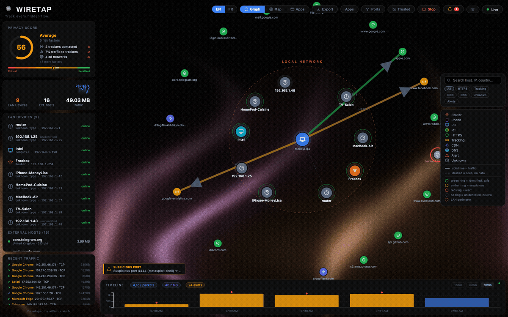

<div align="center">

# Wiretap

**O firewall que sabe se VOCE estava la quando os dados sairam.**

[English](README.md#english) | [Français](README.md#français) | [Español](README.es.md) | [Deutsch](README.de.md) | [Русский](README.ru.md) | [日本語](README.ja.md) | **Português** | [中文](README.zh-CN.md)

⭐ **Se o Wiretap te ajuda, uma estrela significa muito!** ⭐

[](LICENSE)
[]()
[]()
[-blue.svg)]()
[](https://github.com/aixisstudio/Wiretap/releases/latest)
[](https://github.com/aixisstudio/Wiretap/stargazers)

<!-- PT-BR: Captura ao vivo do modo demo (WIRETAP_DEMO=1) — apenas tráfego sintético. -->


</div>

---

**Wiretap** é um visualizador de tráfego de rede em tempo real.
Veja cada conexão que seu computador faz — com quem fala, onde está e qual aplicativo é o responsável.

Toda a interface está disponível em **English, Français, Español, Deutsch, Русский, 日本語, Português (BR) e 简体中文**: use o seletor de idioma na barra de ferramentas.

### Por que Wiretap?

- **vs Little Snitch / Lulu** — mesma ideia (visibilidade por app + regras de bloqueio de saída), mas o Wiretap é multiplataforma, gratuito e open-source. O bloqueio é orquestrado pelo firewall nativo do SO (`netsh` / `iptables` / `pf`) — o Wiretap nunca filtra em user-space.
- **vs GlassWire** — Wiretap é gratuito, open-source (AGPL), sem conta e **zero chamadas externas** sem opt-in; até a geolocalização é offline.
- **vs Wireshark** — Wiretap dá uma visão geral ao vivo que qualquer um lê, em vez de dissecação bruta de pacotes.
- **vs monitores na nuvem** — tudo roda em `127.0.0.1` atrás de um token; seus dados de tráfego nunca saem da máquina.

### Os sinais profundos — v1.9

Tudo o que uma ferramenta de rede clássica ve, mais tudo o que ela nao ve. O ciclo de intrusão fechado de ponta a ponta:

| Sinal | O que faz |
|---|---|
| **Exfiltracao correlacionada a presença** | 5 MB para um provedor de IA enquanto você digita e você usando sua IDE; os mesmos 5 MB na sua ausencia sao outra coisa agindo em seu nome. Tempo ocioso de input lido sem privilegios — `UNATTENDED_EXFIL`. Ninguem mais cruza fluxos com presença humana |
| **Flow DNA** | Metabolismo de rede por processo — tamanhos de burst, ritmo, razão saída:entrada, entropia de destinos — aprendido em silencio e depois pontuado. Um app comprometido mantem o nome mas muda o metabolismo. Alertas `FLOW_DRIFT` se autoexplicam |
| **Vereditos por linhagem** | `navegador -> sh -> curl -> evil.bin` conta a historia que um nome de processo esconde — scoring de ascendencia com frases de evidencia |
| **Vigilancia de persistencia** | LaunchAgents, chaves Run, systemd, cron — cada mecanismo de autostart fingerprintado e comparado a cada 5 min. Sobreviver ao reboot e o que o malware mais precisa; `PERSISTENCE_NEW/MOD/DEL` |
| **Raio de blast** | Todo alerta critico carrega uma avaliação de impacto calculada — destinos alcancados, exposição IA, segredos ao alcance, sobrevivência ao reboot. Triage em uma frase em vez de investigação |
| **Diff temporal** | «O que mudou nesta máquina desde terca?» — snapshots por hora, retenção 48 h, aparecido/sumido/mutado em milissegundos |
| **Log forense inviolavel** | Cada alerta hash-encadeado ao anterior — um atacante que apaga alertas quebra a cadeia: a deleção vira evidencia. Verificacao offline em `/forensic/verify` |
| **Correlacao kill-chain** | 3 familias de detectores distintas na mesma entidade em 15 min nao e ruido — e um incidente único, narrado como timeline, que pode disparar o lockdown automático |
| **Governanca do trafego IA** | Contagem de bytes por (provedor, processo) em 21 provedores de IA, alertas shadow-AI no primeiro contato, detecção de exportação massiva — so metadados, nunca conteúdo |
| **Vigilancia de segredos** | DLP local — suas chaves API colhidas de env/dotfiles (valores nunca saem da RAM), alertadas quando cruzam a rede em claro ou fluem para um provedor de IA |
| **Governanca MCP** | Auditoria de risco de cada servidor MCP declarado em Cursor / Claude / Windsurf / Zed / VS Code / Devin — lançadores download-and-run, acesso a filesystem sem escopo: a nova superfície de ataque dos agentes IA |
| **Vigilancia supply-chain** | `POSTINSTALL_NET` — um processo nunca visto que se conecta minutos após uma instalação e a assinatura do comprometimento supply-chain |
| **Canarios + honeyports + resposta auto** | Arquivos-armadilha anti-ransomware, listeners passivos LAN em telnet/SMB/RDP/VNC, lockdown ou suspensão opt-in em alertas críticos — detecção que age |
| **Firewall DNS + perfis de rede** | Proxy DNS filtrante com upstream DoH criptografado e blocklists curadas; perfis de firewall trocados automaticamente por SSID/BSSID Wi-Fi |
| **Consultas em linguagem natural** | `/ask` — «algo falou com a Russia esta semana?» respondido deterministicamente do SQLite, nunca alucinado |

### Funcionalidades

| Recurso | Descrição |
|---|---|
| Grafo de força | Grafo de nós ao vivo — sua máquina no centro, cada conexão um nó |
| Mapa mundial | IPs geolocalizados com arcos animados num globo interativo |
| Timeline 15/30/60 min | Histórico deslizante local em SQLite (retenção de 24 h) |
| Detecção de anomalias | Varreduras de portas, beaconing (C2 em intervalo regular), exfiltração potencial |
| Detecção avançada | Heurística de túnel DNS, portas em claro, desvio de baseline de país por app |
| Orquestração de firewall | Regras de bloqueio (IP/CIDR/domínio/processo/porta) aplicadas ao firewall do SO — `netsh`/`iptables`/`pf`, persistidas, contadores por regra |
| Modo lockdown | Botão de pânico — sinaliza e bloqueia todo tráfego de saída público; a LAN continua |
| Resposta a incidentes | Matar / suspender processo, bloquear IP — um clique no detalhe da conexão |
| Threat intelligence | Verificações de reputação **opt-in** (AbuseIPDB / AlienVault OTX / VirusTotal) com sua própria chave de API — desligado por padrão, resultados em cache |
| Auditoria de segurança | Relatório de hardening integrado — pontuação, achados, recomendações em linguagem clara |
| Exportação forense | Pacote de investigação em um clique — árvore de processos + SHA-256 do binário, histórico e alertas relacionados (JSON/CSV/STIX) |
| Webhooks de alerta | Encaminhamento **opt-in** de alertas warning/críticos para Discord, Slack, Telegram ou qualquer endpoint |
| Atribuição de processo | Saiba qual app gera qual tráfego (top 5 por conexão) |
| Scanner LAN | Descoberta passiva pela tabela ARP do sistema (sem scans broadcast) |
| Privacy Score | Pontuação em tempo real da exposição do seu tráfego de saída |
| Visão por aplicativo | Destinos, volumes e histórico de 60 min por processo |
| Supressão de alertas | Regras «ignorar host/tipo» persistidas, gerenciáveis na UI |
| Painel de configurações | Idioma, retenção, filtros, download GeoIP com consentimento, diagnóstico |
| Detecção de trackers | Listas de domínios por sufixo em arquivos editáveis (`backend/classifier/lists/`) |
| Monitor de banda | Sparkline de MB/s ao vivo |
| UI em 8 idiomas | EN · FR · ES · DE · RU · JA · PT-BR · ZH-CN — troca em um clique, locales em `frontend/src/locales/` |
| Tema claro / escuro | Segue a preferência do SO, alternância manual persistida |
| Atualização automática | O app desktop consulta o GitHub Releases (desativável em Configurações; `WIRETAP_NO_UPDATE=1`) |
| QUIC / HTTP/3 | Fluxos UDP/443 rotulados honestamente — o SNI do QUIC é criptografado e nunca lido |
| Watchlist | Fixe IPs/domínios — alerta dedicado no primeiro contato |
| Alerta de pico de upload | Teto de MB/min por processo com limiar ajustável |
| Seletor de interface | Escolha qual adaptador é monitorado — sem variável de ambiente |
| Contexto Wi-Fi | SSID atual na barra de ferramentas |
| Exportação | Grafo + alertas para JSON/CSV, um clique |

### Download

| Plataforma | Pacote |
|---|---|
| **macOS (Apple Silicon)** | `brew install --cask aixisstudio/tap/wiretap` — ou **Wiretap.app** zip/dmg da [última release](https://github.com/aixisstudio/Wiretap/releases/latest) |
| **Linux** | **Wiretap AppImage / .deb / .rpm / .snap** da [última release](https://github.com/aixisstudio/Wiretap/releases/latest) — ou `sudo docker compose up --build`, veja [Docker (Linux)](#docker-linux) |
| **Headless (qualquer SO)** | `brew install aixisstudio/tap/wiretap` → daemon `wiretapd` (servidores/VMs, sem GUI) |
| **Windows** | **Wiretap Setup** `.exe` — instalador NSIS de um clique (app nativo, prompt UAC ao abrir, verificação de Npcap embutida) da [última release](https://github.com/aixisstudio/Wiretap/releases/latest). Alternativa lite: `Wiretap-Lite-Setup` (backend + UI no navegador). Requer [Npcap](https://npcap.com/) |
| **Todas (1 clique)** | [Pinokio](https://pinokio.co/apps/github-com-aixisstudio-wiretap) — instala dependências, sobe o backend, abre a UI |

Ou pegue a última release: **[github.com/aixisstudio/Wiretap/releases](https://github.com/aixisstudio/Wiretap/releases)**

> **Primeira execução no macOS** — o Wiretap é assinado ad-hoc, não notarizado (sem Apple Developer ID pago). O `brew install --cask` remove a quarentena para você. Para o zip manual: clique direito → **Abrir**, ou `xattr -dr com.apple.quarantine /Applications/Wiretap.app`. Na primeira execução o Wiretap pede sua senha de admin **uma vez** — a captura de pacotes exige, como tcpdump/Wireshark; a UI permanece sem privilégios.
>
> **Assinatura de código Windows** — os builds Windows serão assinados com Authenticode graças a um certificado open source gratuito da [SignPath Foundation](https://signpath.org) via [SignPath.io](https://signpath.io) (pedido enviado, aguardando aprovação). Até o primeiro build assinado, o SmartScreen pode avisar — clique **Mais informações → Executar mesmo assim**.

### Stack

| Camada | Tecnologia |
|---|---|
| Captura de pacotes | ctypes → libpcap — Npcap (Windows) / libpcap (Linux/macOS) — parser próprio (IPv4/IPv6/TCP/UDP/DNS/TLS-SNI) |
| API backend | FastAPI — WebSockets — SQLite |
| Frontend | React 19 — Vite — D3.js v7 — TopoJSON |
| Empacotador desktop | Electron 44 |
| Geolocalização | **Apenas offline** — DB-IP Lite (CC BY 4.0) embutida gzip em `backend/data/geo/`, extraída na primeira execução; `.mmdb` MaxMind GeoLite2 também suportado |

### Segurança e privacidade

- **Token de API** — todo endpoint REST e o WebSocket exigem token. O Electron o gera por execução; em Docker/navegador é impresso uma vez nos logs e guardado em `data/api_token.txt`. Abra a UI em `http://localhost:8000/?token=<TOKEN>`.
- **Só loopback por padrão** — a API escuta em `127.0.0.1` em todos os modos. Use `WIRETAP_BIND=0.0.0.0` apenas para acesso LAN explícito (o token continua obrigatório).
- **Allowlist CORS/Origin de WebSocket** — apenas `localhost:5173`, a origem do próprio backend e páginas `file://` do Electron podem conectar.
- **Geolocalização 100 % offline** — *nenhuma* consulta online. DB-IP Lite ([CC BY 4.0](https://db-ip.com/db/lite.php)) é extraída para `<data_dir>/geo/`; você pode soltar `.mmdb` MaxMind mais novas ou baixar DB-IP Lite em Configurações (consentimento explícito; as demais chamadas opt-in — threat intel, webhooks, atualizações — estão em [PRIVACY.md](PRIVACY.md)).
- **Todos os dados ficam locais** — `wiretap.db` (janela deslizante de 24 h, `retention_hours`) e `data/logs/wiretap.log` nunca saem da máquina. Sem telemetria. Toda chamada externa é opt-in.
- **Configurações persistem** — filtros de porta, processos excluídos, whitelist de IP, regras de firewall, idioma e retenção são guardados em SQLite e restaurados no reinício.
- **Regras de firewall best-effort** — o backend pilota o firewall do SO (`netsh advfirewall`, `iptables`, âncoras `pf`); sem privilégios a regra é mantida e avaliada para *visibilidade* (alertas BLOCKED_ATTEMPT), marcada «não aplicada» em vez de fingir aplicação. O lockdown mantém loopback + LAN para a UI continuar acessível.
- **Threat intel e webhooks opt-in** — desligados por padrão; ativar um provedor ou webhook adiciona chamadas externas, documentadas em [PRIVACY.md](PRIVACY.md).
- **Supressão de alertas** — cada alerta oferece «Ignorar este tipo/host»; regras persistidas (`alert_suppressions`), gerenciáveis via `POST|DELETE|GET /alerts/ignore`.
- **Histórico** — agregados por minuto, por host e por processo em SQLite (`host_history`, `process_history`), alimentando a visão por aplicativo e `GET /history/*`.
- **Diagnóstico** — `GET /diagnostics` devolve um snapshot JSON do runtime sem segredos; exportável em Configurações.
- **Dispositivos LAN** descobertos passivamente via tabela ARP — sem scan broadcast ativo. Nomes aprendidos do que os próprios dispositivos emitem: mDNS `*.local`, LLMNR/NetBIOS, hostname DHCP, tabela IEEE OUI offline completa; o gateway é detectado como roteador.
- Veja [docs/threat-model.md](docs/threat-model.md) para o modelo de ameaças completo e [docs/FIREWALL.md](docs/FIREWALL.md) para a suíte de segurança.

### Docker (Linux)

O deploy em Docker é para usuários Linux que querem rodar o Wiretap sem instalar mais nada.
A captura funciona via `network_mode: host` — o contêiner vê o tráfego real do host.

**Imagem pronta** — sem clone nem build:

```bash
sudo docker run --network host --cap-add NET_ADMIN --cap-add NET_RAW \
  -v wiretap-data:/app/data ghcr.io/aixisstudio/wiretap
```

> **Nota:** o Docker Desktop no Mac/Windows roda numa VM e não consegue capturar o tráfego do host. Use o app Electron nessas plataformas.

Pegue o token de API (impresso uma vez na inicialização, ou `cat data/api_token.txt`) e abra **http://localhost:8000/?token=TOKEN** no navegador.
Em segundo plano: `sudo docker compose up -d --build`

Limitações do Docker: atribuição de processo restrita aos processos do contêiner; o scanner LAN pode não estar disponível conforme a rede.

### Desenvolvimento

Requisitos: Python 3.11+, Node.js 18+, [Npcap](https://npcap.com/) (só Windows), terminal com privilégios para o backend.

> **Modo demo** — `WIRETAP_DEMO=1` alimenta tráfego sintético pelo pipeline real: sem root, sem libpcap, sem pacotes reais. Ideal para capturas de tela e testes.

```bash
cd backend && pip install -r requirements.txt && python run_backend.py
cd frontend && npm install && npm run dev   # http://localhost:5173/?token=TOKEN
cd electron && npm install && VITE_DEV=1 npx electron .
```

Testes:

```bash
cd backend && pip install -r requirements-dev.txt && python -m pytest tests/ -v
cd frontend && npm test
```

### Estrutura do projeto

```
wiretap/
├── backend/       FastAPI + captura libpcap (ctypes, parser próprio)
├── frontend/      UI React + D3.js (8 idiomas)
├── electron/      Empacotador Electron (main, splash, preload)
├── data/          Dados em execução (SQLite, .mmdb em geo/)
└── dist/          Saída compilada (exe do backend, instalador)
```

---

### Enterprise e frota

O Wiretap também roda headless para implantações SOC — tudo por arquivos e grátis:

- **Security-as-Code** — um `wiretap.toml` (ou `$WIRETAP_CONFIG`) sobrescreve todas as configurações; provisione frotas com Ansible (`deploy/ansible/`), Puppet, Salt ou GPO.
- **Agente Rust** — um daemon sem dependências (`agent/`) envia sockets a `POST /ingest/events` com atribuição `/proc`→PID no Linux; `POST /ingest/enroll` emite tokens `sagt_…` de uso único (hasheados, revogáveis).
- **Nativo em SIEM** — syslog CEF ou RFC 3164, webhooks genéricos e `GET /forensics/export?format=ecs` (NDJSON Elastic Common Schema) alimentam Wazuh, Splunk, Graylog, Loki e Elastic. Importação Sigma (`POST /alerts/rules/sigma`), exportação YARA-L (`GET /alerts/rules/yaral`).
- **Visão da frota** — `GET /remote/fleet` funde as auditorias de todos os pares; um chart Helm (`deploy/helm/wiretap`) roda o coletor no cluster.
- **Feeds de TI gratuitos** — `POST /firewall/blocklist` importa listas de domínios (StevenBlack) e IPs (Blocklist.de, URLhaus/Feodo); `ti_feeds` agenda atualizações automáticas.

Receitas passo a passo em [docs/INTEGRATIONS.md](docs/INTEGRATIONS.md).

## Licença

AGPL v3 — veja [LICENSE](LICENSE). Livre para usar, estudar e modificar; obras derivadas devem permanecer open source sob AGPL v3.

## Histórico de estrelas

[](https://star-history.com/#aixisstudio/Wiretap&Date)
