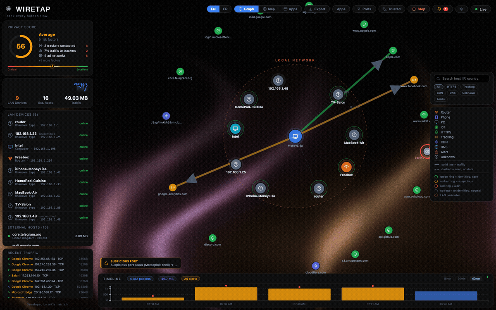

<div align="center">

# Wiretap

**Файрвол, который знает, были ли ВЫ рядом, когда данные ушли.**

[English](README.md#english) | [Français](README.md#français) | [Español](README.es.md) | [Deutsch](README.de.md) | **Русский** | [日本語](README.ja.md) | [Português](README.pt-BR.md) | [中文](README.zh-CN.md)

⭐ **Если Wiretap полезен — звезда много значит!** ⭐

[](LICENSE)
[]()
[]()
[-blue.svg)]()
[](https://github.com/aixisstudio/Wiretap/releases/latest)
[](https://github.com/aixisstudio/Wiretap/stargazers)

<!-- RU: Скрин демо-режима (WIRETAP_DEMO=1) — только синтетический трафик. -->


</div>

---

**Wiretap** — визуализатор сетевого трафика в реальном времени.
Видно каждое соединение компьютера: с кем он говорит, где находится собеседник и какое приложение отвечает.

Весь интерфейс доступен на **English, Français, Español, Deutsch, Русский, 日本語, Português (BR) и 简体中文**: переключатель языка в панели инструментов.

### Зачем Wiretap?

- **vs Little Snitch / Lulu** — та же идея (видимость по приложениям + правила блокировки), но Wiretap кроссплатформен, бесплатен и открыт. Блокировка оркестрируется через нативный фаервол ОС (`netsh` / `iptables` / `pf`) — Wiretap никогда не фильтрует в user-space.
- **vs GlassWire** — Wiretap бесплатен, open source (AGPL), без аккаунта и **не делает исходящих вызовов** без opt-in; даже геолокация офлайн.
- **vs Wireshark** — Wiretap даёт живой высокоуровневый обзор вместо сырой диссекции пакетов.
- **vs облачные мониторы** — всё работает на `127.0.0.1` за токеном; данные трафика не покидают машину.

### Глубокие сигналы — v1.9

Всё, что видит классический сетевой инструмент, плюс всё, чего он не видит. Цикл вторжения, закрытый от начала до конца:

| Сигнал | Что делает |
|---|---|
| **Эксфильтрация с корреляцией присутствия** | 5 МБ к AI-провайдеру, пока вы печатаете — это вы с вашей IDE; те же 5 МБ в ваше отсутствие — нечто действует от вашего имени. Время простоя ввода читается без привилегий — `UNATTENDED_EXFIL`. Больше никто не связывает потоки с присутствием человека |
| **Flow DNA** | Сетевой метаболизм каждого процесса — размеры всплесков, ритм, соотношение исходящего к входящему, энтропия назначений — обучается молча, затем оценивается. Скомпрометированное приложение сохраняет имя, но меняет метаболизм. Алерты `FLOW_DRIFT` объясняют себя сами |
| **Вердикты по происхождению** | `браузер -> sh -> curl -> evil.bin` рассказывает историю, которую скрывает голое имя процесса — скоринг родословной с доказательными фразами |
| **Наблюдение за персистентностью** | LaunchAgents, ключи Run, systemd, cron — каждый механизм автозапуска снимается с отпечатка и сравнивается каждые 5 минут. Пережить перезагрузку — главная потребность малвари; `PERSISTENCE_NEW/MOD/DEL` |
| **Радиус поражения** | Каждый критический алерт несёт вычисленную оценку ущерба — достигнутые назначения, AI-экспозиция, доступные секреты, переживание перезагрузки. Триаж одной фразой вместо расследования |
| **Разница во времени** | «Что изменилось на этой машине со вторника?» — ежечасные снапшоты, хранение 48 ч, появилось/исчезло/мутировало за миллисекунды |
| **Неподделываемый форензик-журнал** | Каждый алерт хеш-связан с предыдущим — атакующий, стирающий алерты, ломает цепь: само удаление становится доказательством. Офлайн-проверка на `/forensic/verify` |
| **Корреляция kill-chain** | 3 разных семейства детекторов на одной сущности за 15 минут — не шум, а один инцидент, рассказанный как таймлайн, способный запустить автоматический lockdown |
| **Управление AI-трафиком** | Подсчёт байтов по (провайдер, процесс) для 21 AI-провайдера, алерты shadow-AI при первом контакте, детект массового экспорта — только метаданные, никогда содержимое |
| **Наблюдение за секретами** | Локальный DLP — ваши API-ключи собраны из env/dotfiles (значения никогда не покидают RAM), алерт когда они пересекают сеть в открытом виде или текут к AI-провайдеру |
| **Управление MCP** | Аудит рисков каждого MCP-сервера из Cursor / Claude / Windsurf / Zed / VS Code / Devin — загрузчики download-and-run, неограниченный доступ к файлам: новая поверхность атаки AI-агентов |
| **Наблюдение за supply-chain** | `POSTINSTALL_NET` — невиданный процесс, выходящий в сеть через минуты после установки — сигнатура компрометации цепочки поставок |
| **Канарейки + ханипорты + автоответ** | Файлы-приманки против ransomware, пассивные LAN-слушатели на telnet/SMB/RDP/VNC, opt-in lockdown или приостановка процесса при критических алертах — детект, который действует |
| **DNS-файрвол + сетевые профили** | Фильтрующий DNS-прокси с шифрованным DoH-апстримом и курируемыми блоклистами; профили файрвола переключаются автоматически по SSID/BSSID Wi-Fi |
| **Запросы на естественном языке** | `/ask` — «что-то говорило с Россией на этой неделе?» — детерминистический ответ из SQLite, никогда не галлюцинация |

### Возможности

| Функция | Описание |
|---|---|
| Force-граф | Живой граф узлов — машина в центре, каждое соединение — узел |
| Карта мира | Геолокализованные IP с анимированными дугами на интерактивном глобусе |
| Таймлайн 15/30/60 мин | Скользящая история локально в SQLite (хранение 24 ч) |
| Детекция аномалий | Сканирование портов, beaconing (C2 через равные интервалы), потенциальная эксфильтрация |
| Продвинутая детекция | Эвристика DNS-туннеля, незашифрованные порты, отклонение от странового профиля приложения |
| Оркестрация фаервола | Правила блокировки (IP/CIDR/домен/процесс/порт) применяются к фаерволу ОС — `netsh`/`iptables`/`pf`, персистентность, счётчики блокировок |
| Режим lockdown | Паническая кнопка — помечает и блокирует весь исходящий публичный трафик, LAN остаётся |
| Реагирование на инциденты | Убить / приостановить процесс, заблокировать IP — в один клик из деталей соединения |
| Threat intelligence | **Opt-in** проверки репутации (AbuseIPDB / AlienVault OTX / VirusTotal) с вашим API-ключом — выключено по умолчанию, результаты кэшируются |
| Аудит безопасности | Встроенный отчёт харденинга — оценка, находки, рекомендации простым языком |
| Форензик-экспорт | Пакет расследования в один клик — дерево процессов + SHA-256 бинарника, история и связанные тревоги (JSON/CSV/STIX) |
| Webhook-оповещения | **Opt-in** пересылка warning/critical-тревог в Discord, Slack, Telegram или любой endpoint |
| Атрибуция процессов | Какая программа генерирует какой трафик (топ-5 на соединение) |
| LAN-сканер | Пассивное обнаружение по системной ARP-таблице (без broadcast-сканов) |
| Privacy Score | Живая оценка экспозиции исходящего трафика |
| Вид по приложениям | Назначения, объёмы и история 60 мин по процессам |
| Подавление тревог | Персистентные правила «игнорировать хост/тип», управляемые в UI |
| Панель настроек | Язык, хранение, фильтры, загрузка GeoIP с согласия, диагностика |
| Детекция трекеров | Списки доменов по суффиксам в редактируемых файлах (`backend/classifier/lists/`) |
| Монитор полосы | Живой спарклайн MB/s |
| UI на 8 языках | EN · FR · ES · DE · RU · JA · PT-BR · ZH-CN — переключение в один клик, локали в `frontend/src/locales/` |
| Светлая/тёмная тема | По умолчанию следует системе, ручное переключение сохраняется |
| Автообновление | Десктоп-приложение проверяет GitHub Releases (отключается в настройках; `WIRETAP_NO_UPDATE=1`) |
| QUIC / HTTP/3 | Потоки UDP/443 помечаются честно — SNI в QUIC зашифрован и не читается |
| Watchlist | Закрепите IP/домены — отдельная тревога при первом контакте |
| Тревога пика отправки | Потолок МБ/мин на процесс с настраиваемым порогом |
| Выбор интерфейса | Какой адаптер слушать — без переменных окружения |
| Контекст Wi-Fi | Текущий SSID в панели инструментов |
| Экспорт | Граф + тревоги в JSON/CSV в один клик |

### Скачать

| Платформа | Пакет |
|---|---|
| **macOS (Apple Silicon)** | `brew install --cask aixisstudio/tap/wiretap` — или **Wiretap.app** zip/dmg из [последнего релиза](https://github.com/aixisstudio/Wiretap/releases/latest) |
| **Linux** | **Wiretap AppImage / .deb / .rpm / .snap** из [последнего релиза](https://github.com/aixisstudio/Wiretap/releases/latest) — или `sudo docker compose up --build`, см. [Docker (Linux)](#docker-linux) |
| **Headless (любая ОС)** | `brew install aixisstudio/tap/wiretap` → демон `wiretapd` (серверы/ВМ, без GUI) |
| **Windows** | **Wiretap Setup** `.exe` — установщик NSIS в один клик (нативное приложение, UAC при запуске, проверка Npcap встроена) из [последнего релиза](https://github.com/aixisstudio/Wiretap/releases/latest). Облегчённая альтернатива: `Wiretap-Lite-Setup` (бэкенд + UI в браузере). Требуется [Npcap](https://npcap.com/) |
| **Все (1 клик)** | [Pinokio](https://pinokio.co/apps/github-com-aixisstudio-wiretap) — ставит зависимости, запускает бэкенд, открывает UI |

Или возьмите последний релиз: **[github.com/aixisstudio/Wiretap/releases](https://github.com/aixisstudio/Wiretap/releases)**

> **Первый запуск на macOS** — Wiretap подписан ad-hoc, без нотаризации (нет платного Apple Developer ID). `brew install --cask` снимает карантин за вас. Для ручного zip: правый клик → **Открыть**, или `xattr -dr com.apple.quarantine /Applications/Wiretap.app`. При первом запуске Wiretap **один раз** спросит пароль администратора — захват пакетов этого требует, как tcpdump/Wireshark; UI остаётся без привилегий.
>
> **Подпись кода Windows** — сборки Windows будут подписываться Authenticode бесплатным open-source сертификатом [SignPath Foundation](https://signpath.org) через [SignPath.io](https://signpath.io) (заявка подана, ожидает одобрения). До первой подписанной сборки SmartScreen может предупреждать — **Подробнее → Выполнить в любом случае**.

### Стек

| Слой | Технология |
|---|---|
| Захват пакетов | ctypes → libpcap — Npcap (Windows) / libpcap (Linux/macOS) — собственный парсер (IPv4/IPv6/TCP/UDP/DNS/TLS-SNI) |
| Backend API | FastAPI — WebSockets — SQLite |
| Frontend | React 19 — Vite — D3.js v7 — TopoJSON |
| Десктоп-обёртка | Electron 44 |
| Геолокация | **Только офлайн** — DB-IP Lite (CC BY 4.0) идёт gzip'нутой в `backend/data/geo/`, распаковывается при первом запуске; поддерживаются и `.mmdb` MaxMind GeoLite2 |

### Безопасность и приватность

- **API-токен** — каждый REST-endpoint и WebSocket требуют токен. Electron генерирует его при запуске; в Docker/браузере печатается один раз в логах и сохраняется в `data/api_token.txt`. Откройте UI: `http://localhost:8000/?token=<ТОКЕН>`.
- **Только loopback по умолчанию** — API слушает `127.0.0.1` во всех режимах. `WIRETAP_BIND=0.0.0.0` — только для явного LAN-доступа (токен обязателен).
- **Allowlist CORS/Origin для WebSocket** — подключаться могут только `localhost:5173`, собственный origin бэкенда и `file://`-страницы Electron.
- **Геолокация 100 % офлайн** — *никаких* онлайн-запросов. DB-IP Lite ([CC BY 4.0](https://db-ip.com/db/lite.php)) распаковывается в `<data_dir>/geo/`; можно положить свежие `.mmdb` MaxMind или скачать DB-IP Lite в настройках (явное согласие; остальные opt-in вызовы — threat intel, webhooks, обновления — в [PRIVACY.md](PRIVACY.md)).
- **Все данные локальны** — `wiretap.db` (скользящее окно 24 ч, `retention_hours`) и `data/logs/wiretap.log` не покидают машину. Никакой телеметрии. Каждый исходящий вызов — opt-in.
- **Настройки сохраняются** — фильтры портов, исключённые процессы, белый список IP, правила фаервола, язык и хранение — в SQLite, восстанавливаются при рестарте.
- **Правила фаервола best-effort** — бэкенд управляет фаерволом ОС (`netsh advfirewall`, `iptables`, якоря `pf`); без привилегий правило сохраняется и матчится для *видимости* (тревоги BLOCKED_ATTEMPT) с честной меткой «не применено». Lockdown сохраняет loopback + LAN.
- **Threat intel и webhooks — opt-in** — выключены по умолчанию; включение провайдера или webhook добавляет исходящие вызовы (см. [PRIVACY.md](PRIVACY.md)).
- **Подавление тревог** — у каждой тревоги есть «Игнорировать тип/хост»; правила персистентны (`alert_suppressions`), управляются через `POST|DELETE|GET /alerts/ignore`.
- **История** — поминутные агрегаты по хостам и процессам в SQLite (`host_history`, `process_history`), питают вид по приложениям и `GET /history/*`.
- **Диагностика** — `GET /diagnostics` возвращает JSON-снимок среды без секретов; экспортируется из настроек.
- **LAN-устройства** обнаруживаются пассивно по ARP-таблице — без активных сканов. Имена — из того, что устройства сами вещают: mDNS `*.local`, LLMNR/NetBIOS, hostname DHCP, полная офлайн-таблица IEEE OUI; шлюз определяется как роутер.
- См. [docs/threat-model.md](docs/threat-model.md) для модели угроз и [docs/FIREWALL.md](docs/FIREWALL.md) для security-набора.

### Docker (Linux)

Docker-развёртывание — для пользователей Linux, запускающих Wiretap без установки чего-либо ещё.
Захват работает через `network_mode: host` — контейнер видит реальный трафик хоста.

**Готовый образ** — без клонирования и сборки:

```bash
sudo docker run --network host --cap-add NET_ADMIN --cap-add NET_RAW \
  -v wiretap-data:/app/data ghcr.io/aixisstudio/wiretap
```

> **Примечание:** Docker Desktop на Mac/Windows работает внутри VM и не может захватывать трафик хоста. Используйте приложение Electron.

Токен API — выводится один раз при запуске или `cat data/api_token.txt`, затем откройте **http://localhost:8000/?token=ТОКЕН** в браузере.
В фоне: `sudo docker compose up -d --build`

Ограничения Docker: атрибуция процессов — только процессы контейнера; LAN-сканер может быть недоступен в некоторых сетях.

### Разработка

Требования: Python 3.11+, Node.js 18+, [Npcap](https://npcap.com/) (только Windows), терминал администратора для бэкенда.

> **Демо-режим** — `WIRETAP_DEMO=1` прогоняет синтетический трафик через настоящий pipeline: ни root, ни libpcap, ни реальных пакетов. Идеально для скриншотов и тестов.

```bash
cd backend && pip install -r requirements.txt && python run_backend.py
cd frontend && npm install && npm run dev   # http://localhost:5173/?token=ТОКЕН
cd electron && npm install && VITE_DEV=1 npx electron .
```

Тесты:

```bash
cd backend && pip install -r requirements-dev.txt && python -m pytest tests/ -v
cd frontend && npm test
```

### Структура проекта

```
wiretap/
├── backend/       FastAPI + захват libpcap (ctypes, собственный парсер)
├── frontend/      UI на React + D3.js (8 языков)
├── electron/      Обёртка Electron (main, splash, preload)
├── data/          Данные выполнения (SQLite, .mmdb в geo/)
└── dist/          Сборка (exe бэкенда, установщик)
```

---

### Enterprise и флот

Wiretap работает и headless для SOC-развёртываний — всё через файлы и бесплатно:

- **Security-as-Code** — один `wiretap.toml` (или `$WIRETAP_CONFIG`) переопределяет все настройки; флоты через Ansible (`deploy/ansible/`), Puppet, Salt или GPO.
- **Rust-агент** — демон без зависимостей (`agent/`) шлёт сокеты в `POST /ingest/events` с атрибуцией `/proc`→PID в Linux; `POST /ingest/enroll` выдаёт одноразовые `sagt_…` токены (хэшированные, отзываемые).
- **SIEM-нативно** — syslog CEF или RFC 3164, универсальные webhook и `GET /forensics/export?format=ecs` (NDJSON Elastic Common Schema) питают Wazuh, Splunk, Graylog, Loki и Elastic. Импорт Sigma (`POST /alerts/rules/sigma`), экспорт YARA-L (`GET /alerts/rules/yaral`).
- **Вид флота** — `GET /remote/fleet` объединяет аудиты всех пиров; Helm-чарт (`deploy/helm/wiretap`) запускает коллектор в кластере.
- **Бесплатные TI-фиды** — `POST /firewall/blocklist` импортирует доменные (StevenBlack) и IP-списки (Blocklist.de, URLhaus/Feodo); `ti_feeds` планирует автообновления.

Пошаговые рецепты: [docs/INTEGRATIONS.md](docs/INTEGRATIONS.md).

## Лицензия

AGPL v3 — см. [LICENSE](LICENSE). Свободно использовать, изучать и изменять; производные должны оставаться open source под AGPL v3.

## История звёзд

[](https://star-history.com/#aixisstudio/Wiretap&Date)
